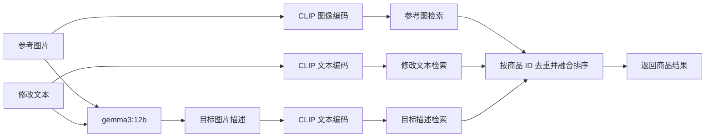

# FashionIQ 三路图文商品检索

这是一个面向服饰商品的图文检索项目。用户提供一张参考图和一段修改描述，系统从商品图库中检索符合目标的商品。

检索使用 OpenAI CLIP ViT-L/14 生成图文向量，使用 Ollama `gemma3:12b` 根据中文提示词生成英文目标图片描述，再对三路候选去重和加权排序。

## 检索流程



## 三路召回与排序

三路分别独立计算 CLIP 余弦相似度，各召回前 100 个候选：

1. **参考图**：寻找视觉上与输入图片相似的商品。
2. **修改文本**：根据用户输入的修改要求检索商品。
3. **目标描述**：`gemma3:12b` 结合参考图和修改文字生成目标外观描述，再进行文本检索。

候选按商品 ID 合并去重，使用加权倒数名次融合（Weighted RRF，`k=60`）：

```text
融合得分 = Σ 权重 × 61 / (60 + 该路名次)
```

默认权重为参考图 **0.25**、修改文本 **0.15**、目标描述 **0.60**。商品未进入某一路的前 100 名时，该路贡献为 0。融合得分用于排序，不代表匹配概率。参考商品会从结果中排除。

## 主要组件

| 路径 | 用途 |
| --- | --- |
| `fashioniq_retrieval/core.py` | CLIP 编码、三路检索、去重与加权 RRF |
| `fashioniq_retrieval/vision.py` | 使用中文提示词调用 Ollama 并解析目标图片描述 |
| `fashioniq_retrieval/service.py` | 提供本地 HTTP 检索接口 |
| `mall-portal/.../FashionIqSearchController.java` | 接收搜索页请求、代理检索服务并返回商品信息 |
| `mall-app-web/src/pages/product/search.vue` | 图文搜索页面及结果展示 |

## 运行准备

需要 Python、可用的 FashionIQ 商品图片和商品目录、Ollama，以及 CLIP ViT-L/14 权重文件。模型权重、图片和向量索引不包含在 Git 仓库中。

安装 Python 依赖：

```powershell
python -m pip install -r fashioniq_retrieval/requirements.txt
```

启动 Ollama 并准备视觉模型：

```powershell
ollama pull gemma3:12b
```

将 CLIP 权重放到 `fashioniq_retrieval/models/ViT-L-14.pt`。图片目录按 `dress`、`shirt`、`toptee` 分类。建索引时，程序从商品目录读取已上架商品，并匹配本地图片；默认 Docker MySQL 容器名为 `mall-mysql`，需设置 `MALL_DB_PASSWORD`：

```powershell
$env:MALL_DB_PASSWORD = "你的数据库密码"
$env:FASHIONIQ_IMAGE_ROOT = "D:\dataset\fashioniq"
python -m fashioniq_retrieval index
```

索引写入 `fashioniq_retrieval/index/`，该目录被 Git 忽略。更新商品或图片后需要重新建索引。

## 启动检索服务

```powershell
python -m fashioniq_retrieval.service --host 0.0.0.0 --port 8765
```

通过 `GET http://localhost:8765/health` 查看服务状态、索引商品数和当前融合权重。搜索页面调用 Portal 的 `POST /product/visualSearch`；检索服务也提供 `POST /search`，接收参考图片（Base64）或参考商品 ID、修改文本、类别和结果数量。

上传图片最大 5 MB，修改文本最多 500 字。服务使用 Ollama JSON 输出模式生成目标描述；默认请求超时为 180 秒。

## 调整检索参数

启动 Python 服务前可通过环境变量设置路由权重、每路候选数和 RRF 参数：

```powershell
$env:FASHIONIQ_WEIGHT_REFERENCE = "0.25"
$env:FASHIONIQ_WEIGHT_MODIFICATION = "0.15"
$env:FASHIONIQ_WEIGHT_TARGET = "0.60"
$env:FASHIONIQ_BRANCH_TOP_K = "100"
$env:FASHIONIQ_RRF_K = "60"
```

权重会自动归一化。也可使用 `OSRCIR_VISION_MODEL` 更换默认视觉模型。

## CLI 示例

使用索引中的商品作为参考图：

```powershell
python -m fashioniq_retrieval search `
  --reference-product-id 100000 `
  --text "make it shorter and black" `
  --category dress `
  --top-k 10
```

也可用 `--reference-image` 指定本地参考图片。传入 `--target-description` 可直接指定目标描述；修改文本仍需提供，以保留第二路检索。
